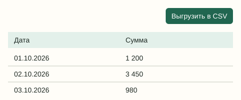
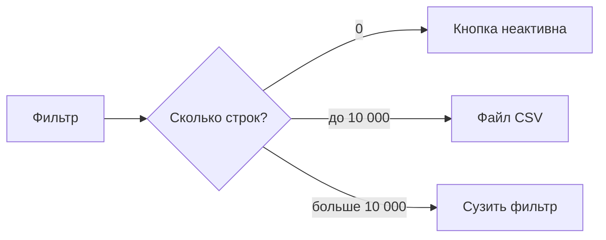

# Выгрузка отфильтрованных строк в CSV

## Проблема
В CSV попадают **все** строки отчёта, хотя пользователь отобрал фильтром только нужные.

> Пользователь: «Я отфильтровал 120 строк, а в файле их 4 000».

## Границы
| Случай | Ожидаемый результат |
| --- | --- |
| Фильтр отобрал 120 строк | В CSV 120 строк и строка заголовков |
| Фильтр ничего не отобрал | Кнопка выгрузки неактивна |
| Больше 10 000 строк | Система предлагает сузить фильтр |

- Меняется только выгрузка в продукте A.
- Продукт B *не затронут*.



Пример файла выгрузки:

```csv
Дата;Сумма
01.10.2026;1200
```



## Перед согласованием
- [x] Проблема описана словами пользователя
- [ ] Границы подтверждены владельцем решения

## Задача
`[PILOT-001](https://jira.example.invalid/browse/PILOT-001)`
